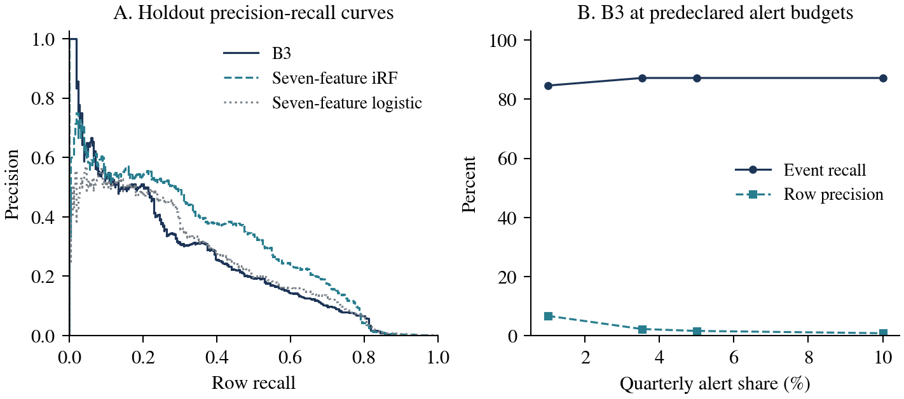
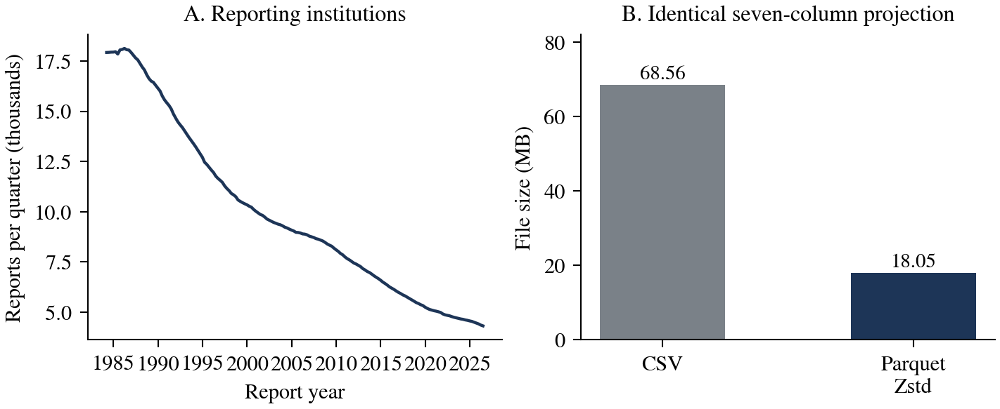

# Bank-Failure Early Warning Using FDIC Data

**Nguyễn Lê Nam Khánh · Financial Data & Risk Analytics · NEU BFT65B**

A reproducible financial-data engineering project: collect FDIC reports, reconcile accounting values, build a bank-quarter panel, validate risk rankings through time, and quantify the workload behind an alert policy.

**Scale:** 1,682,616 Financials rows · 170 quarters · 87 source fields · 64 historical validation folds / 49 distinct train windows.

**Read first:** [executed notebook](notebooks/fdic_bank_failure_early_warning.ipynb) · [pdfLaTeX report, 14 main pages + 1 appendix page](reports/FDIC_Risk_Analytics_Report.pdf) · [HTML notebook](reports/portfolio.html) · [CV wording](docs/CV_PROJECT.md).

Repository: [khanhnlmneuron6-hue/fdic-bank-failure-risk-analytics](https://github.com/khanhnlmneuron6-hue/fdic-bank-failure-risk-analytics). This is an academic project, not EY work or a regulator-approved system.

## Why this project matters

Financial models depend on consistent data, not just an estimator. This project handles changing field definitions, valid negative capital, structural missingness, YTD income flows, uncertain exits and publication-lag assumptions. Changes are traceable, source values remain immutable, and model preprocessing is fitted on training observations only.

The deliverables demonstrate Python, SQL reconciliation examples, pandas/Polars, Parquet, PySpark/MLlib, data testing, financial feature engineering, model comparison and communication of risk/workload trade-offs. There is no Power BI/Tableau dashboard or AML/fraud claim.

## What the results actually show

| Evaluation | B3 AP-D7 | Core7 iRF AP-D7 | Scope |
|---|---:|---:|---|
| Fixed-origin dev | 0.2481 | 0.2196 | Historical outer-validation predictions |
| Rolling-5y dev | 0.2133 | 0.1978 | Historical outer-validation predictions |
| Frozen holdout | **0.2506** | **0.3098** | As-of 2013Q1-2025Q2; once evaluated |

B3 was selected from development evidence. It **does not beat the simpler iRF reference on holdout AP**. This finding is retained without post-test model selection.

At the illustrative dev-selected **top 3.53% each quarter**, B3 detects **68/78 events (87.2%)**, with **82.5% bank-quarter recall** and **2.23% precision** (212 TP and 9,310 FP). A detected event means at least one eligible positive quarter was alerted; it does not mean all of its risky quarters were ranked well. This is a review prioritization prototype, not a production accuracy claim.



## Pipeline

```text
FDIC API -> immutable raw pages + manifests -> typed quarter Parquet
         -> financial quality rules + reversible cell ledgers
         -> exact-quarter flows / TTM / changes + eligible labels
         -> time-ordered inner selection + outer development comparisons
         -> frozen final model + declared cost-policy scenario
         -> one holdout scoring pass -> aggregate reports and explanations
```

The 37-cell notebook is a concise evidence narrative; scientific functions live in `src/fdic_risk/`. Historical research pilots/debugging cells are not in the public notebook. The original 600+ cell working notebook was preserved privately and left unchanged.

## Measured engineering evidence

On the same **1,350,892-row / 7-column dev projection**, Parquet Zstd is **18.05 MB vs 68.56 MB CSV**, approximately **3.80x smaller**. Median warm-cache scan + exact-quarter join + ratios + aggregate: **0.073 s Polars vs 0.569 s pandas**, over three repetitions on the recorded laptop. These timings are workload-specific, not universal speed claims.

The corresponding local Spark result matches both engines numerically. A separate MLlib LR demonstration fits through 2009 and evaluates 2011, AP 0.1925 / ROC-AUC 0.9633. Its approximate median and penalty differ from sklearn; it is not a matched-model winner.



## Cost and threshold: evidence, proxies, assumptions

The action is an offsite desk review. Both true and false alerts incur review work; missed failures are counted once per event. The model does not itself prevent failure.

- **Measured from saved predictions:** alert counts, new/repeat chains, missed events and lead time.
- **Observed retrospective severity:** revised FDIC COST, converted with CPI to 2012 prices. Zero and missing COST remain distinct.
- **External proxy:** OCC's USD110/hour special-examination fee; not measured FDIC labour cost.
- **Illustrative assumptions:** 4-hour new review, repeat fraction 0.5, severity weight `alpha=0.001`; the finite-grid dev minimum selects 3.53%. These are not identified causal effects or validated staffing capacity.

The report includes alternative alpha values, 4/12-hour and repeat-effort cases, staffing and escalation sensitivity, and break-even descriptors. It does not report real savings. See [sources](references/README.md), [frozen scenario](docs/cost_policy.json) and [test contract](docs/frozen_test_protocol.json).

## Reproduce the public presentation (no bank-level data needed)

Use Python **3.11**. Create a virtual environment, then:

```bash
python -m pip install -r requirements.txt
python -m pip install -e . --no-deps
python -m pytest -q
python scripts/run_pipeline.py --mode replay
```

Or open `notebooks/fdic_bank_failure_early_warning.ipynb` and **Run All**. Replay reads public aggregate tables, regenerates figures and does not train or reopen the test. Saved notebook outputs are already included.

The report follows the assignment sequence from acquisition through modelling and conclusions. Its [editorial review](docs/EDITORIAL_REVIEW.md) records the writing guidance used and the preservation of scientific meaning. The report is compiled with **pdfLaTeX and BibTeX**. Install TeX Live/TinyTeX plus `requirements-report.txt`, then run `python scripts/build_report.py`. Editable [TeX source](reports/manuscript/main.tex), [local style](reports/manuscript/fdicpaper.sty) and [BibTeX references](reports/manuscript/references.bib) are included. See the [build/style guide](docs/REPORT_STYLE_GUIDE.md) for TeX packages, manual compilation and the typography rules. `python scripts/build_paper_figures.py` redraws vector publication figures from saved aggregates only. The [source audit](docs/SOURCE_AUDIT.md) separates verified references, project measurements and assumptions that citations cannot settle. Java 17+ is needed only when rerunning Spark. On macOS/conda, set `JAVA_HOME` to the installed JDK if Spark cannot discover it.

## Reconstruct the private computation from raw

Do not overwrite the frozen release to conduct new research. Create an independent reproduction workspace:

```bash
python scripts/new_reproduction_workspace.py /absolute/path/to/private-reproduction
cd /absolute/path/to/private-reproduction
python scripts/acquire.py
python scripts/run_pipeline.py --mode rebuild --spark --evaluate-test
```

This performs acquisition, feature reconstruction, explicit development replay when old predictions are unavailable, final fitting, scenario selection, benchmarks and fixed-protocol scoring. The dev replay is expensive: it repeats inner forward search on the registered 64-fold schedule; allow hours rather than the seconds needed for presentation replay. `python scripts/reproduce_backtest.py` runs that selected path explicitly. Downloaded values may differ from the 6 November 2026 snapshot because FDIC revises data.

**Execution boundary:** the release's historical multi-selector and multi-model rounds were not all rerun during curation. Their versioned aggregate evidence is preserved. The extracted `backtest.py` is provided for replay of the selected procedure; no new full 64-fold execution of that extracted file is claimed. Acquiring a fresh snapshot and running this private workflow was not repeated during this release. Reproduction of a now-public test is not a fresh independent validation.

Local convenience: `FDIC_SOURCE_ROOT` can point to a pre-existing acquisition/research snapshot. That path is never required by public presentation replay and is never stored in the public bundle.

## Checks and provenance

- Counterexample tests: quota ties; never/always alerts; calendar gaps in repeat chains; event deduplication; undefined metrics; train-only cap state; all-missing training columns.
- Feature reconstruction parity, model reload identity, cross-engine numerical checks and custom Tree SHAP brute-force/additivity checks.
- [Evidence origin hashes](docs/evidence_manifest.json), [scientific rule provenance](docs/rule_provenance.json), [release notes](docs/RELEASE_NOTES.md).
- The first test count assertion stopped before any scores: locked keys include ineligible/censored rows. Applying the existing label rule reconciled 280,267 keys to 273,863 evaluable rows. The technical resume and one successful scoring pass are disclosed.

## Limitations

Revised data, current Institutions exit evidence and a retrospectively discovered historical quarantine prevent a vintage-perfect real-time claim. Repeated adaptive dev comparisons can create selection bias. The cost scenario lacks measured FDIC effort, capacity and intervention effectiveness. Explanations describe model associations in a dev sample, not causal effects. False alerts and non-crisis performance require further operational validation.

## Publish safely

Use the separately prepared **public export**, not the private working folder. Raw/processed bank data, model binaries, `.local/`, connection files and logs are excluded. Aggregate report tables and plots are intentionally included. See the Vietnamese [GitHub upload guide](docs/GITHUB_UPLOAD_VI.md).

After creating the repository, add its actual URL on the report cover and this README. The exam requires a public repository, an English report, pinned requirements, code/notebook outputs and fixed seeds; do not upload datasets.

## Attribution

[References and implementation attribution](references/README.md) identify sources, code-reading scope and limits. Claude and OpenAI Codex assisted research, implementation and review. The student remains responsible for understanding and defending the work and for disclosing AI use under the course rules.
